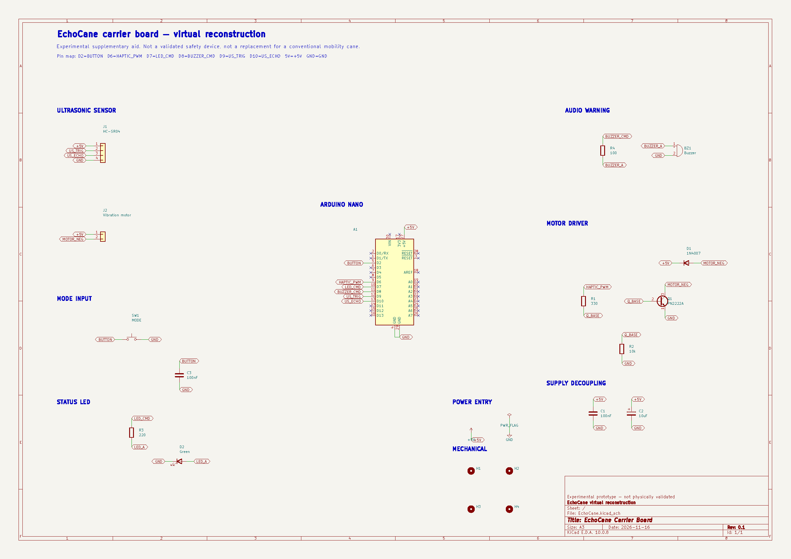
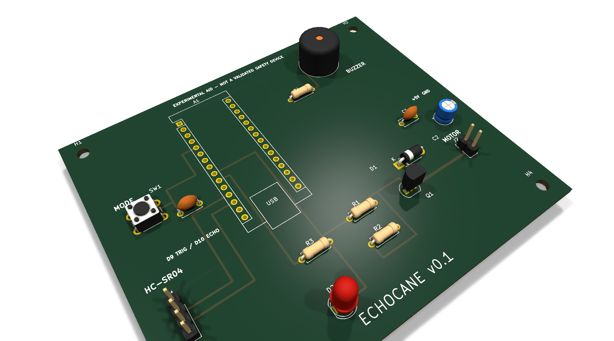
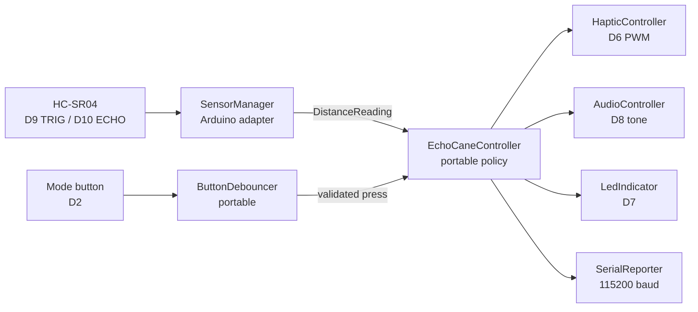

# EchoCane — Arduino Nano Smart-Cane Prototype

**A safety-first embedded systems project: portable C++ policy core, Arduino Nano firmware, HC-SR04 sensing, PWM haptic drive, KiCad hardware and a documented verification trail.**

[](https://platformio.org/)
[](firmware/)
[](https://www.microchip.com/en-us/product/ATmega328P)
[](hardware/)
[](firmware/test/test_core/)
[](hardware/verification/schematic-erc.rpt)
[](hardware/verification/pcb-drc.rpt)
[](LICENSE)

EchoCane is an experimental supplementary mobility aid that measures the distance
to the nearest surface with an HC-SR04 ultrasonic sensor and gives graded tactile
and audible warnings. This repository reconstructs the concept as a complete,
testable embedded-engineering portfolio project: portable C++ policy code,
Arduino Nano firmware, Wokwi simulation assets, native unit tests, a KiCad
carrier board, manufacturing outputs and engineering documentation.

> **Project intent:** this is an engineering case study, not a medical device or
a validated navigation product. The interesting part is the discipline around
it: bounded sensing, explicit fault behaviour, host-testable policy code,
power/thermal checks, editable PCB sources and an honest limitations register.

> **Safety notice**
> EchoCane is an experimental supplementary aid. It is **not** a replacement for
> a conventional mobility cane and has **not** been validated with users or on
> physical hardware. The distance thresholds in this repository are demonstration
> parameters, not safety limits. Do not use this design as a sole mobility aid.

> **Evidence notice**
> No physical Arduino, sensor, motor or PCB was available. Firmware compilation,
> host unit tests, schematic/PCB checks and an ngspice driver simulation were
> executed. Wokwi assets were validated structurally, but the Wokwi scenarios
> were **not executed** here because the Wokwi CLI and CI token were unavailable.
> Simulation is not physical validation.

## Contents

- [The problem](#the-problem)
- [What this project demonstrates](#what-this-project-demonstrates)
- [Demonstrated behaviour](#demonstrated-behaviour)
- [Status at a glance](#status-at-a-glance)
- [Visual gallery](#visual-gallery)
- [Features](#features)
- [Technology stack](#technology-stack)
- [Architecture](#architecture)
- [Repository layout](#repository-layout)
- [Quick start](#quick-start)
- [PCB](#pcb)
- [Engineering decisions and trade-offs](#engineering-decisions-and-trade-offs)
- [Pin map](#pin-map)
- [Audit corrections](#audit-corrections)
- [Engineering limitations](#engineering-limitations)
- [Documentation](#documentation)
- [License](#license)

## The problem

A white cane is effective because it gives direct, continuous mechanical feedback
about the ground and nearby objects. An electronic aid can complement it by
warning about obstacles before contact, but it introduces new failure modes:
sensor dropouts, blind angles, false confidence and output masking. EchoCane is
therefore designed around an explicit safety rule:

**A failed or unavailable sensor must never be reported as an obstacle-free path.**

The project explores that rule through a small, understandable system rather than
claiming to solve navigation for visually impaired users.

## What this project demonstrates

- **Safety-first firmware policy.** Invalid sensor readings never map to a
  clear-path result; the system moves through `CAUTION`/`FAULT`, requires
  consecutive confirmations, and only recovers after consecutive valid reads.
- **A testable embedded architecture.** Classification, hysteresis, debounce,
  scheduling and mode policy live in a portable C++ library with no Arduino
  dependency; hardware-specific `pulseIn`, `analogWrite`, `tone` and `millis`
  adapters stay at the edge.
- **Resource-aware AVR work.** The Nano build is constrained and measured:
  **10,766 / 30,720 bytes flash (35.0%)** and **777 / 2,048 bytes RAM (37.9%)**.
- **Real hardware engineering.** A complete KiCad 10 schematic and 2-layer PCB,
  editable sources, Gerbers, Excellon drill, drill map, STEP, schematic/PCB
  previews and an independent ERC/DRC/parity trail.
- **Analog and power reasoning.** The motor driver was sized around the loaded
  ATmega328P GPIO, R2 loading and a forced-beta target; the 1N4007 was checked
  against the actual 976.56 Hz PWM period and the design-current margins.
- **Reproducible evidence.** Deterministic schematic/PCB generators,
  cross-artifact validators, native unit tests and simulator assets are checked
  into the repository instead of being described only in prose.
- **Engineering honesty.** The audit findings, unresolved physical-validation
  gaps and design limitations are published alongside the passing checks.

### How to review this repository

| If you have… | Start here |
|---|---|
| 2 minutes | This README, then the [schematic](hardware/schematic/EchoCane-schematic.pdf) |
| 10 minutes | [Architecture](docs/architecture.md) and [circuit explanation](docs/circuit-explanation.md) |
| 30 minutes | [Independent audit](docs/audit-report.md), [requirements](docs/requirements.md) and [testing strategy](docs/testing-strategy.md) |
| A hardware/embedded interview | [Engineering decisions](#engineering-decisions-and-trade-offs), [pin map](#pin-map), [limitations](#engineering-limitations) |

## Demonstrated behaviour

| Measured distance | Alert level | Haptic pattern | Buzzer (Assist/Diagnostic) | LED |
|---|---|---|---|---|
| > 150 cm | `CLEAR` | off | off | short heartbeat |
| 80–150 cm inclusive | `CAUTION` | 40 %, 180 ms on / 320 ms off | 1800 Hz, 60 ms / 1140 ms | 120 ms blink |
| < 80 cm | `DANGER` | 100 %, 400 ms on / 120 ms off | 2400 Hz, 90 ms / 210 ms | solid |
| invalid / timeout | `CAUTION` first, then `FAULT` | fault pattern | 1000 Hz fault pattern | fast fault blink |

Hysteresis is asymmetric: a warning engages at the threshold but releases only
after the distance improves by 10 cm. This prevents chatter around 80 cm and
150 cm. The exact policy is in
[`ObstacleDetector.cpp`](firmware/lib/echocane_core/src/ObstacleDetector.cpp)
and is covered by unit tests.

A confirmed sensor fault requires **3 consecutive invalid acquisitions**. Recovery
requires **3 consecutive valid acquisitions**, and the system remains at least at
`CAUTION` while degraded or recovering. A failed acquisition holds the last
warning rather than clearing it.

## Status at a glance

| Check | Result | Evidence |
|---|---|---|
| Arduino Nano firmware build | **PASS** — 10,766 / 30,720 bytes flash (35.0 %), 777 / 2,048 bytes RAM (37.9 %) | PlatformIO `nanoatmega328` |
| Host unit tests | **PASS** — 25 / 25 | `pio test -e native` |
| Wokwi structural validation | **PASS** — 6 diagrams with explicit pin/stimulus mappings, 0 warnings | `python tests/validate_simulation.py` |
| Wokwi scenario execution | **NOT VERIFIED (NOT RUN)** — CLI/token unavailable | no serial logs claimed |
| Schematic ERC | **PASS** — 0 errors, 0 warnings | `hardware/verification/schematic-erc.rpt` |
| PCB DRC | **PASS** — 0 DRC violations, 0 unconnected pads, 0 schematic-parity issues | `hardware/verification/pcb-drc.rpt` |
| Cross-artifact consistency | **PASS** — 12 nets, 19 components, 15 BOM rows, 8 Wokwi links agree | `python tests/validate_hardware.py` |
| Driver design margins | **PASS** — 270 Ω, 4.2 V loaded GPIO, 11.0 mA base, forced beta 9.10 | `simulation/simulide/driver-analysis.json` |
| ngspice driver simulation | **EXECUTED** — 12.04 mA base, 104.37 mA motor, 0.0945 V Vce, 5.63 V flyback clamp | `simulation/simulide/ngspice-results.txt` |
| Independent engineering audit | **PASS** for every available check; physical/external checks remain open | [`docs/audit-report.md`](docs/audit-report.md) |
| Remote GitHub Actions execution | **PASS** — firmware/tests and KiCad ERC/DRC jobs completed successfully on GitHub | [EchoCane CI run 43788851832](https://github.com/cn108/EchoCane/actions/runs/43788851832) |
| Physical hardware / user validation | **NOT VERIFIED (not performed)** | no hardware available |

## Visual gallery

<p align="center">
  
  
</p>

<p align="center">
  <em>A4 schematic with visible functional-block wiring; 3D top render of the 100 × 85 mm carrier PCB.</em>
</p>

Additional views: [schematic PDF](hardware/schematic/EchoCane-schematic.pdf),
[PCB PDF](hardware/pcb/EchoCane-pcb.pdf),
[3D bottom](images/EchoCane-3d-bottom.png),
[driver waveform](images/driver-waveform.svg).

## Features

- Cooperative application loop with 60 ms sensor scans, 5 ms button polling and
  scheduled haptic/audio/LED patterns. The HC-SR04 acquisition is bounded but
  blocking for up to 25 ms; it is not a hard-real-time loop.
- Five-sample median filter, asymmetric hysteresis, invalid-reading handling,
  timeout detection, fault confirmation and recovery.
- Three operating modes: **Assist** (haptic + audio), **Quiet** (haptic only) and
  **Diagnostic** (full warnings plus faster telemetry).
- Portable `echocane_core` library with no Arduino dependencies; host-testable
  policy and hardware adapters behind small interfaces.
- Serial diagnostics with a stable machine-readable `EC|...` telemetry record.
- Complete KiCad 10 schematic, 2-layer carrier PCB, 3D render, Gerbers and drill
  files.
- Reproducible hardware generators for the schematic, PCB and BOM.

## Technology stack

| Layer | Tool / part |
|---|---|
| Microcontroller | Arduino Nano, ATmega328P, classic 5 V, 16 MHz |
| Firmware | C++17, Arduino framework, PlatformIO |
| Host tests | PlatformIO native environment + Unity |
| Simulation | Wokwi (Arduino Nano, HC-SR04, LEDs, buzzer, button) |
| Supplementary circuit analysis | ngspice transient model; SimulIDE build guide |
| PCB | KiCad 10.0.8, `kicad-cli`, Docker |
| CI | GitHub Actions (build, tests, validators, KiCad checks, optional Wokwi) |

## Architecture



The core owns classification, hysteresis, fault/recovery, mode selection and
alert-pattern selection. The Arduino adapters own pins, `pulseIn`, `analogWrite`,
`tone` and `millis`. `EchoCaneController` can therefore be compiled and tested on
a host without an Arduino.

## Repository layout

```text
EchoCane/
├── firmware/
│   ├── include/                 # Arduino-facing adapters and pin map
│   ├── src/                     # SensorManager, outputs, main.cpp
│   ├── lib/echocane_core/       # portable policy library
│   └── test/test_core/          # 25 Unity tests, native environment
├── hardware/
│   ├── kicad/                   # schematic, PCB, project, netlist
│   ├── schematic/               # PDF and SVG
│   ├── pcb/                     # PDF, SVG, STEP
│   ├── gerber/                  # Gerbers, Excellon drill, drill map, job file
│   ├── bom/                     # design BOM
│   ├── verification/            # ERC/DRC reports and board statistics
│   └── generate_*.py            # reproducible generators
├── simulation/
│   ├── wokwi/                   # diagram.json, wokwi.toml, scenarios
│   ├── simulide/                # guide, ngspice model, driver calculations
│   └── scenarios/               # scenario matrix
├── tests/                       # structural, cross-artifact and Wokwi runners
├── docs/                        # engineering documentation
├── images/                      # rendered evidence
├── .github/workflows/           # CI and optional Wokwi job
├── platformio.ini
├── README.md
└── LICENSE
```

## Quick start

### Prerequisites

- Python 3.11+ and [PlatformIO](https://platformio.org/) (the repository uses a
  local `.venv` on Windows).
- VS Code with the PlatformIO and Wokwi extensions for interactive simulation.
- Docker for reproducing the native tests or KiCad checks on a machine without a
  host toolchain.
- KiCad 10 for opening the PCB project; `kicad-cli` for the command-line checks.

### Build and test without hardware or a Wokwi token

```bash
# from the repository root
python -m venv .venv
# Windows: .venv/Scripts/pip install platformio
# Linux/macOS: .venv/bin/pip install platformio
.venv/Scripts/pio run -e nanoatmega328
.venv/Scripts/pio test -e native

python tests/validate_simulation.py
python tests/validate_hardware.py
```

On Linux/macOS, use `.venv/bin/pio`. Native tests use the host compiler and do
not require an Arduino, a sensor or a Wokwi subscription.

Docker equivalents:

```bash
# native unit tests
MSYS_NO_PATHCONV=1 docker run --rm -v "$PWD:/work" -w /work \
  python:3.12-bookworm bash -lc \
  'python -m pip install -q platformio; pio test -e native'

# ERC and DRC (reports are written into the workspace)
docker run --rm -v "$PWD:/work" -w /work kicad/kicad:10.0 bash -lc '
  kicad-cli sch erc --severity-all --exit-code-violations \
    -o hardware/verification/schematic-erc.rpt \
    hardware/kicad/EchoCane.kicad_sch &&
  kicad-cli pcb drc --severity-all --exit-code-violations \
    --schematic-parity --refill-zones \
    -o hardware/verification/pcb-drc.rpt \
    hardware/kicad/EchoCane.kicad_pcb'
```

### Run the Wokwi simulation

1. Build the Nano firmware: `pio run -e nanoatmega328`.
2. Open **`simulation/wokwi`** as the VS Code workspace folder (or select
   `simulation/wokwi/wokwi.toml` as the Wokwi configuration). The TOML paths
   resolve to the repository root's `.pio` build.
3. Open `diagram.json` and start the Wokwi simulation. The main diagram starts
   with the HC-SR04 at 300 cm.
4. Drag the HC-SR04 distance control to 120 cm and then 50 cm. Confirm the serial
   telemetry changes to `level=CAUTION` and `level=DANGER`; the haptic LED and
   buzzer follow the configured patterns. The vibration motor is represented by
   a PWM-driven LED because Wokwi has no vibration-motor part.
5. Press the mode button to cycle `ASSIST → QUIET → DIAGNOSTIC`.
6. For sensor-fault behaviour, open
   `scenarios/diagrams/sensor_fault.json`; ECHO is tied to GND, so the firmware
   must report `DEGRADED` and then `FAULT`, never `free=1`.

The five automated scenarios and their per-scenario diagrams are listed in
[`simulation/scenarios/README.md`](simulation/scenarios/README.md). They require
the Wokwi CLI and `WOKWI_CLI_TOKEN`:

```bash
python tests/run_wokwi_scenarios.py --dry-run   # show commands, no token needed
export WOKWI_CLI_TOKEN=...                      # never commit this value
python tests/run_wokwi_scenarios.py
```

The local build, host tests, ERC and DRC do **not** require a token.

## PCB

The carrier board is **100 × 85 mm**, 2-layer, 1.6 mm FR-4, designed around the
classic 30-pin Arduino Nano module. It includes an HC-SR04 4-pin connector, a
2-pin vibration-motor connector, a PN2222A low-side switch with a 270 Ω base
resistor and 10 kΩ pull-down, a 1N4007 flyback diode, motor supply decoupling, a
mode button with an RC debounce capacitor, a status LED, a buzzer and four M3
mounting holes.

| Item | Result |
|---|---|
| Schematic | KiCad 10, A4 landscape, ERC 0 errors / 0 warnings |
| PCB | 15 electrical footprints + 4 mounting holes, all tracks routed |
| DRC | 0 violations, 0 unconnected pads, 0 schematic-parity issues |
| Board statistics | 63 PTH pads, 4 NPTH, 0 vias, 0.5 mm minimum track, 0.75 mm minimum drill |
| Manufacturing | Gerbers, Excellon drill, drill map PDF, Gerber job file, STEP |
| 3D | Top and bottom renders; the Nano module's vendor model is not in the installed KiCad library, so A1 is shown by its footprint outline (see the audit report) |

**Preview:** [schematic PDF](hardware/schematic/EchoCane-schematic.pdf) ·
[PCB PDF](hardware/pcb/EchoCane-pcb.pdf) ·
[Gerber directory](hardware/gerber/) ·
[3D bottom](images/EchoCane-3d-bottom.png)


The schematic is drawn on **A4 landscape** as labelled functional blocks with
visible local wiring; global labels are used only for the long
Nano-to-peripheral signal runs. It is an editable KiCad schematic, not only an
image or PDF.

The sole 5 V source is the Nano's USB connection. On a classic Nano, USB VBUS
passes through the module's onboard Schottky diode to the 5 V rail; the Nano 5V
pin is an **output**, and the carrier has no external 5 V input. Do not backfeed
the `+5V` net while USB is connected. The `PWR_FLAG` is on GND only because the
Nano's 5V pin already drives `+5V`; adding a second +5 V flag would conflict in
ERC.

### Power Design

**Power Design Disclaimer:** The v0.1 schematic is powered directly via the Arduino Nano's USB port for prototyping. The vibration motor's stall current may exceed the USB port's safe limits. The final production design will include a dedicated 5V voltage regulator and a Li-ion battery management circuit.

The 1N4007 flyback diode was checked against D6's **976.56 Hz** Timer0A PWM
(1.024 ms period). Its 1 A average / 30 A surge ratings are far above the 100 mA
design point, and its conservative 30 µs recovery interval is only about 2.9% of
the period. No diode change is justified at this frequency and current; the
1N4007 and PCB remain unchanged.

The board has not been fabricated, assembled or electrically tested. Gerbers are
design outputs, not manufacturing approval.

### Reproduce the hardware artifacts

```bash
# schematic, netlist, BOM, ERC
MSYS_NO_PATHCONV=1 docker run --rm -v "$PWD:/work" -w /work \
  kicad/kicad:10.0-full bash -lc '
  python3 hardware/generate_schematic.py &&
  kicad-cli sch erc --severity-all --exit-code-violations \
    -o hardware/verification/schematic-erc.rpt \
    hardware/kicad/EchoCane.kicad_sch &&
  kicad-cli sch export netlist --format kicadsexpr \
    -o hardware/kicad/EchoCane.net hardware/kicad/EchoCane.kicad_sch'

# PCB from the netlist, then DRC
MSYS_NO_PATHCONV=1 docker run --rm -v "$PWD:/work" -w /work \
  kicad/kicad:10.0-full bash -lc '
  python3 hardware/generate_pcb.py &&
  kicad-cli pcb drc --severity-all --exit-code-violations \
    --schematic-parity --refill-zones \
    -o hardware/verification/pcb-drc.rpt \
    hardware/kicad/EchoCane.kicad_pcb'
```

The detailed layer/export commands are in
[`docs/hardware-design.md`](docs/hardware-design.md).

## Engineering decisions and trade-offs

| Decision | Why it was chosen | What it costs |
|---|---|---|
| **270 Ω base resistor + PN2222A** | Uses the loaded-GPIO bound, includes R2 loading and meets the forced-beta-10 target at 100 mA | Motor current above the ~110 mA forced-beta-10 ceiling is not covered; stall current is unverified |
| **USB-only 5 V architecture** | The Nano's USB input is the intended source; no unvalidated charger or second regulator is added | The carrier is tethered; no external 5 V input or ORing/backfeed protection is fitted |
| **1N4007 flyback diode retained** | 1 A / 30 A / 1000 V ratings and ≤30 µs recovery are adequate at 976.56 Hz and 100 mA | It is not a fast-recovery/Schottky part; revisit if PWM frequency or stall current rises |
| **Portable `echocane_core` library** | Policy can be compiled and tested on the host without Arduino headers | Hardware adapters remain thin and must be reviewed separately |
| **Wokwi actuator proxy** | A PWM LED lets the command path be exercised without a vibration-motor model | It does not prove tactile output, motor torque or acoustic behaviour |
| **Local wires + long-distance labels** | Local block circuits are visually traceable; Nano-to-block nets stay readable | Cross-sheet connectivity is label-based, not one continuous drawn wire |
| **A4 landscape schematic** | Compact enough to read as a single engineering sheet while keeping the Nano central | More constrained placement than an A3 sheet; labels and sections must be kept disciplined |

## Pin map

| Signal | Nano pin | ATmega328P port | Connects to |
|---|---|---|---|
| HC-SR04 TRIG | D9 | PB1 | J1 pin 2 |
| HC-SR04 ECHO | D10 | PB2 | J1 pin 3 |
| Haptic PWM | D6 | PD6 / Timer0A | R1 → Q1 base |
| Buzzer | D8 | PB0 | R4 → BZ1 |
| Mode button | D2 | PD2 | SW1 to GND, active low |
| Status LED | D7 | PD7 | R3 → D2 |
| +5 V | 5V | — | J1.1, J2.1, D1 cathode, C1, C2 |
| GND | GND | — | J1.4, Q1 emitter, R2, C1, C2, C3, D2 cathode, SW1, BZ1 |

The same assignments are asserted across `Pins.h`, the KiCad netlist, the BOM
and the Wokwi diagram by `tests/validate_hardware.py`.

## Audit corrections

An independent audit rechecked the full repository rather than relying on the
initial status table. It corrected the forced-beta inequality in the driver
calculation, changed R1 from 1 kΩ to 330 Ω, then found that the 330 Ω result still
assumed an ideal 5 V GPIO and omitted the R2 loading. The final loaded-GPIO
calculation uses the ATmega328P datasheet VOH of 4.2 V at 20 mA, a 270 Ω resistor
and a 10 kΩ pull-down: 11.11 mA from the pin, 10.99 mA into the base and forced
beta 9.10 at the 100 mA design point. The 300 Ω case is also above the calculated
296.4 Ω limit and was rejected. The audit also removed an unrepresented optional
H5–H6 BOM row; moved C2 to give the two 5 mm capacitors mechanical clearance;
restored the board title-block revision; strengthened Wokwi validation to assert
exact GPIO/stimulus mappings; removed dead configuration; added an overflow-safe
echo conversion; and expanded the native suite from 18 to 25 tests. All generated
hardware outputs were regenerated. The full findings, evidence and remaining gaps
are in [`docs/audit-report.md`](docs/audit-report.md) and
[`docs/limitations-register.md`](docs/limitations-register.md).

## Engineering limitations

- **No physical validation.** No hardware was purchased or assembled. The
  firmware, PCB and simulation have not been tested against a real HC-SR04,
  vibration motor, buzzer or power supply.
- **Wokwi distance automation.** Wokwi's HC-SR04 does not expose a documented
  distance automation control. The automated scenarios therefore use static
  per-scenario diagrams and the moving-away case is a documented manual
  procedure. The scenarios were structurally validated but not executed here.
- **No vibration motor in Wokwi.** A PWM-driven LED and serial telemetry stand in
  for the actuator command. This proves the command path, not tactile output.
- **SimulIDE is not installed.** A validated `.simu` file is not included. The
  repository provides a precise SimulIDE build guide, executable design
  calculations and an executed ngspice transient model of the driver. The motor
  is a lumped 47 Ω / 10 mH model; it is not a tactile or acoustic validation.
- **Sensor physics.** Ultrasonic sensing is poor for soft, angled, narrow,
  transparent or cloth-like obstacles, and cannot detect drop-offs, stairs or
  overhead objects. See [`docs/safety-analysis.md`](docs/safety-analysis.md).
- **Demonstration thresholds.** 150 cm and 80 cm are configurable engineering
  defaults. They are not clinically or ergonomically validated.
- **PCB is unmanufactured.** DRC/ERC clean results do not prove assembly yield,
  EMC, thermal behaviour or connector reliability. The Nano module's 3D model is
  absent from the installed KiCad library, so it is not in the STEP/render. A
  CC0 candidate model exists, but it was not independently dimensionally verified
  and is therefore not included; see [`docs/limitations-register.md`](docs/limitations-register.md).
- **Power.** The design assumes a commercially manufactured regulated 5 V USB
  source. No lithium-ion charging circuit is designed or validated. The design
  budget is 174.7 mA for a 100 mA motor, 25 mA Nano allowance, 15 mA sensor peak,
  11.1 mA base drive, 10 mA buzzer and 13.6 mA LED, leaving 325.3 mA of nominal
  USB headroom. Motor stall current is unknown and can exceed the 100 mA design
  point; the selected drive supports only about 109.9 mA at forced beta 10, so a
  larger motor requires a new driver/current check.

## Documentation

- [Requirements](docs/requirements.md)
- [Architecture](docs/architecture.md)
- [Hardware design](docs/hardware-design.md)
- [Circuit explanation and calculations](docs/circuit-explanation.md)
- [Software design](docs/software-design.md)
- [Independent engineering audit](docs/audit-report.md)
- [Outstanding limitations register](docs/limitations-register.md)
- [Testing strategy and results](docs/testing-strategy.md)
- [Simulation limitations](docs/simulation-limitations.md)
- [Safety analysis](docs/safety-analysis.md)
- [Development history and milestones](docs/development-history.md)
- [Scenario matrix](simulation/scenarios/README.md)

## Author

Built and documented as an embedded-systems portfolio project by
**[@cn108](https://github.com/cn108)**.

## License

MIT — see [LICENSE](LICENSE). The design is provided as an educational portfolio
artifact without warranty or fitness for a particular purpose.
