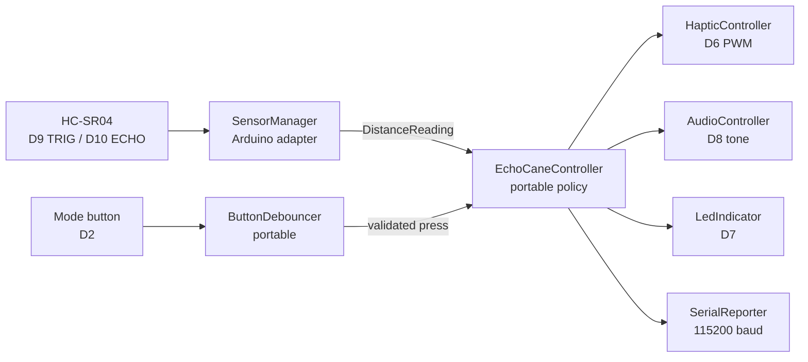

# EchoCane

**Virtual reconstruction and modernisation of an Arduino Nano smart walking stick.**

EchoCane is an experimental supplementary mobility aid that measures the distance
to the nearest surface with an HC-SR04 ultrasonic sensor and gives graded tactile
and audible warnings. This repository reconstructs the concept as a complete,
testable embedded-engineering portfolio project: portable C++ policy code,
Arduino Nano firmware, Wokwi simulation assets, native unit tests, a KiCad
carrier board, manufacturing outputs and engineering documentation.

> **Safety notice**
> EchoCane is an experimental supplementary aid. It is **not** a replacement for
> a conventional mobility cane and has **not** been validated with users or on
> physical hardware. The distance thresholds in this repository are demonstration
> parameters, not safety limits. Do not use this design as a sole mobility aid.

> **Evidence notice**
> No physical Arduino, sensor, motor or PCB was available. Firmware compilation,
> host unit tests, schematic/PCB checks and an ngspice driver simulation were
> executed. Wokwi assets were validated structurally, but the Wokwi scenarios
> were **not executed** here because the Wokwi CLI and CI token were unavailable.
> Simulation is not physical validation.


## The problem

A white cane is effective because it gives direct, continuous mechanical feedback
about the ground and nearby objects. An electronic aid can complement it by
warning about obstacles before contact, but it introduces new failure modes:
sensor dropouts, blind angles, false confidence and output masking. EchoCane is
therefore designed around an explicit safety rule:

**A failed or unavailable sensor must never be reported as an obstacle-free path.**

The project explores that rule through a small, understandable system rather than
claiming to solve navigation for visually impaired users.

## Demonstrated behaviour

| Measured distance | Alert level | Haptic pattern | Buzzer (Assist/Diagnostic) | LED |
|---|---|---|---|---|
| > 150 cm | `CLEAR` | off | off | short heartbeat |
| 80–150 cm inclusive | `CAUTION` | 40 %, 180 ms on / 320 ms off | 1800 Hz, 60 ms / 1140 ms | 120 ms blink |
| < 80 cm | `DANGER` | 100 %, 400 ms on / 120 ms off | 2400 Hz, 90 ms / 210 ms | solid |
| invalid / timeout | `CAUTION` first, then `FAULT` | fault pattern | 1000 Hz fault pattern | fast fault blink |

Hysteresis is asymmetric: a warning engages at the threshold but releases only
after the distance improves by 10 cm. This prevents chatter around 80 cm and
150 cm. The exact policy is in
[`ObstacleDetector.cpp`](firmware/lib/echocane_core/src/ObstacleDetector.cpp)
and is covered by unit tests.

A confirmed sensor fault requires **3 consecutive invalid acquisitions**. Recovery
requires **3 consecutive valid acquisitions**, and the system remains at least at
`CAUTION` while degraded or recovering. A failed acquisition holds the last
warning rather than clearing it.

## Status at a glance

| Check | Result | Evidence |
|---|---|---|
| Arduino Nano firmware build | **PASS** — 10,766 / 30,720 bytes flash (35.0 %), 779 / 2,048 bytes RAM (38.0 %) | PlatformIO `nanoatmega328` |
| Host unit tests | **PASS** — 18 / 18 | `pio test -e native` |
| Wokwi structural validation | **PASS** — 6 diagrams, scenario mappings present, 0 errors | `python tests/validate_simulation.py` |
| Wokwi scenario execution | **NOT RUN** — CLI/token unavailable | no serial logs claimed |
| Schematic ERC | **PASS** — 0 errors, 0 warnings | `hardware/verification/schematic-erc.rpt` |
| PCB DRC | **PASS** — 0 DRC violations, 0 unconnected pads, 0 schematic-parity issues | `hardware/verification/pcb-drc.rpt` |
| Cross-artifact consistency | **PASS** — 12 nets, 19 components, 15 BOM rows, 8 Wokwi links agree | `python tests/validate_hardware.py` |
| ngspice driver simulation | **EXECUTED** — 4.16 mA base, 103.7 mA motor, 0.124 V Vce, 5.77 V flyback clamp | `simulation/simulide/ngspice-results.txt` |
| Physical hardware / user validation | **NOT PERFORMED** | no hardware available |

## Features

- Non-blocking application loop with 60 ms sensor scans, 5 ms button polling and
  scheduled haptic/audio/LED patterns.
- Five-sample median filter, asymmetric hysteresis, invalid-reading handling,
  timeout detection, fault confirmation and recovery.
- Three operating modes: **Assist** (haptic + audio), **Quiet** (haptic only) and
  **Diagnostic** (full warnings plus faster telemetry).
- Portable `echocane_core` library with no Arduino dependencies; host-testable
  policy and hardware adapters behind small interfaces.
- Serial diagnostics with a stable machine-readable `EC|...` telemetry record.
- Complete KiCad 10 schematic, 2-layer carrier PCB, 3D render, Gerbers and drill
  files.
- Reproducible hardware generators for the schematic, PCB and BOM.

## Technology stack

| Layer | Tool / part |
|---|---|
| Microcontroller | Arduino Nano, ATmega328P, classic 5 V, 16 MHz |
| Firmware | C++17, Arduino framework, PlatformIO |
| Host tests | PlatformIO native environment + Unity |
| Simulation | Wokwi (Arduino Nano, HC-SR04, LEDs, buzzer, button) |
| Supplementary circuit analysis | ngspice transient model; SimulIDE build guide |
| PCB | KiCad 10.0.8, `kicad-cli`, Docker |
| CI | GitHub Actions (build, tests, validators, KiCad checks, optional Wokwi) |

## Architecture



The core owns classification, hysteresis, fault/recovery, mode selection and
alert-pattern selection. The Arduino adapters own pins, `pulseIn`, `analogWrite`,
`tone` and `millis`. `EchoCaneController` can therefore be compiled and tested on
a host without an Arduino.

## Repository layout

```text
EchoCane/
├── firmware/
│   ├── include/                 # Arduino-facing adapters and pin map
│   ├── src/                     # SensorManager, outputs, main.cpp
│   ├── lib/echocane_core/       # portable policy library
│   └── test/test_core/          # 18 Unity tests, native environment
├── hardware/
│   ├── kicad/                   # schematic, PCB, project, netlist
│   ├── schematic/               # PDF and SVG
│   ├── pcb/                     # PDF, SVG, STEP
│   ├── gerber/                  # Gerbers, Excellon drill, drill map, job file
│   ├── bom/                     # design BOM
│   ├── verification/            # ERC/DRC reports and board statistics
│   └── generate_*.py            # reproducible generators
├── simulation/
│   ├── wokwi/                   # diagram.json, wokwi.toml, scenarios
│   ├── simulide/                # guide, ngspice model, driver calculations
│   └── scenarios/               # scenario matrix
├── tests/                       # structural, cross-artifact and Wokwi runners
├── docs/                        # engineering documentation
├── images/                      # rendered evidence
├── .github/workflows/           # CI and optional Wokwi job
├── platformio.ini
├── README.md
└── LICENSE
```

## Quick start

### Prerequisites

- Python 3.11+ and [PlatformIO](https://platformio.org/) (the repository uses a
  local `.venv` on Windows).
- VS Code with the PlatformIO and Wokwi extensions for interactive simulation.
- Docker for reproducing the native tests or KiCad checks on a machine without a
  host toolchain.
- KiCad 10 for opening the PCB project; `kicad-cli` for the command-line checks.

### Build and test without hardware or a Wokwi token

```bash
# from the repository root
python -m venv .venv
# Windows: .venv/Scripts/pip install platformio
# Linux/macOS: .venv/bin/pip install platformio
.venv/Scripts/pio run -e nanoatmega328
.venv/Scripts/pio test -e native

python tests/validate_simulation.py
python tests/validate_hardware.py
```

On Linux/macOS, use `.venv/bin/pio`. Native tests use the host compiler and do
not require an Arduino, a sensor or a Wokwi subscription.

Docker equivalents:

```bash
# native unit tests
MSYS_NO_PATHCONV=1 docker run --rm -v "$PWD:/work" -w /work \
  python:3.12-bookworm bash -lc \
  'python -m pip install -q platformio; pio test -e native'

# ERC and DRC (reports are written into the workspace)
docker run --rm -v "$PWD:/work" -w /work kicad/kicad:10.0 bash -lc '
  kicad-cli sch erc --severity-all --exit-code-violations \
    -o hardware/verification/schematic-erc.rpt \
    hardware/kicad/EchoCane.kicad_sch &&
  kicad-cli pcb drc --severity-all --exit-code-violations \
    --schematic-parity --refill-zones \
    -o hardware/verification/pcb-drc.rpt \
    hardware/kicad/EchoCane.kicad_pcb'
```

### Run the Wokwi simulation

1. Build the Nano firmware: `pio run -e nanoatmega328`.
2. Open **`simulation/wokwi`** as the VS Code workspace folder (or select
   `simulation/wokwi/wokwi.toml` as the Wokwi configuration). The TOML paths
   resolve to the repository root's `.pio` build.
3. Open `diagram.json` and start the Wokwi simulation. The main diagram starts
   with the HC-SR04 at 300 cm.
4. Drag the HC-SR04 distance control to 120 cm and then 50 cm. Confirm the serial
   telemetry changes to `level=CAUTION` and `level=DANGER`; the haptic LED and
   buzzer follow the configured patterns. The vibration motor is represented by
   a PWM-driven LED because Wokwi has no vibration-motor part.
5. Press the mode button to cycle `ASSIST → QUIET → DIAGNOSTIC`.
6. For sensor-fault behaviour, open
   `scenarios/diagrams/sensor_fault.json`; ECHO is tied to GND, so the firmware
   must report `DEGRADED` and then `FAULT`, never `free=1`.

The five automated scenarios and their per-scenario diagrams are listed in
[`simulation/scenarios/README.md`](simulation/scenarios/README.md). They require
the Wokwi CLI and `WOKWI_CLI_TOKEN`:

```bash
python tests/run_wokwi_scenarios.py --dry-run   # show commands, no token needed
export WOKWI_CLI_TOKEN=...                      # never commit this value
python tests/run_wokwi_scenarios.py
```

The local build, host tests, ERC and DRC do **not** require a token.

## PCB

The carrier board is **100 × 85 mm**, 2-layer, 1.6 mm FR-4, designed around the
classic 30-pin Arduino Nano module. It includes an HC-SR04 4-pin connector, a
2-pin vibration-motor connector, a PN2222A low-side switch with base resistor and
pull-down, a 1N4007 flyback diode, motor supply decoupling, a mode button with an
RC debounce capacitor, a status LED, a buzzer and four M3 mounting holes.

| Item | Result |
|---|---|
| Schematic | KiCad 10, ERC 0 errors / 0 warnings |
| PCB | 15 electrical footprints + 4 mounting holes, all tracks routed |
| DRC | 0 violations, 0 unconnected pads, 0 schematic-parity issues |
| Board statistics | 63 PTH pads, 4 NPTH, 0 vias, 0.5 mm minimum track, 0.75 mm minimum drill |
| Manufacturing | Gerbers, Excellon drill, drill map PDF, Gerber job file, STEP |
| 3D | Top and bottom renders; the Nano module's vendor 3D model is not in the KiCad library, so A1 is shown by its footprint outline |

**Preview:** [schematic PDF](hardware/schematic/EchoCane-schematic.pdf) ·
[PCB PDF](hardware/pcb/EchoCane-pcb.pdf) ·
[Gerber directory](hardware/gerber/) ·
[3D bottom](images/EchoCane-3d-bottom.png)


The board has not been fabricated, assembled or electrically tested. Gerbers are
design outputs, not manufacturing approval.

### Reproduce the hardware artifacts

```bash
# schematic, netlist, BOM, ERC
MSYS_NO_PATHCONV=1 docker run --rm -v "$PWD:/work" -w /work \
  kicad/kicad:10.0-full bash -lc '
  python3 hardware/generate_schematic.py &&
  kicad-cli sch erc --severity-all --exit-code-violations \
    -o hardware/verification/schematic-erc.rpt \
    hardware/kicad/EchoCane.kicad_sch &&
  kicad-cli sch export netlist --format kicadsexpr \
    -o hardware/kicad/EchoCane.net hardware/kicad/EchoCane.kicad_sch'

# PCB from the netlist, then DRC
MSYS_NO_PATHCONV=1 docker run --rm -v "$PWD:/work" -w /work \
  kicad/kicad:10.0-full bash -lc '
  python3 hardware/generate_pcb.py &&
  kicad-cli pcb drc --severity-all --exit-code-violations \
    --schematic-parity --refill-zones \
    -o hardware/verification/pcb-drc.rpt \
    hardware/kicad/EchoCane.kicad_pcb'
```

The detailed layer/export commands are in
[`docs/hardware-design.md`](docs/hardware-design.md).

## Pin map

| Signal | Nano pin | ATmega328P port | Connects to |
|---|---|---|---|
| HC-SR04 TRIG | D9 | PB1 | J1 pin 2 |
| HC-SR04 ECHO | D10 | PB2 | J1 pin 3 |
| Haptic PWM | D6 | PD6 / Timer0A | R1 → Q1 base |
| Buzzer | D8 | PB0 | R4 → BZ1 |
| Mode button | D2 | PD2 | SW1 to GND, active low |
| Status LED | D7 | PD7 | R3 → D2 |
| +5 V | 5V | — | J1.1, J2.1, D1 cathode, C1, C2 |
| GND | GND | — | J1.4, Q1 emitter, R2, C1, C2, C3, D2 cathode, SW1, BZ1 |

The same assignments are asserted across `Pins.h`, the KiCad netlist, the BOM
and the Wokwi diagram by `tests/validate_hardware.py`.

## Engineering limitations

- **No physical validation.** No hardware was purchased or assembled. The
  firmware, PCB and simulation have not been tested against a real HC-SR04,
  vibration motor, buzzer or power supply.
- **Wokwi distance automation.** Wokwi's HC-SR04 does not expose a documented
  distance automation control. The automated scenarios therefore use static
  per-scenario diagrams and the moving-away case is a documented manual
  procedure. The scenarios were structurally validated but not executed here.
- **No vibration motor in Wokwi.** A PWM-driven LED and serial telemetry stand in
  for the actuator command. This proves the command path, not tactile output.
- **SimulIDE is not installed.** A validated `.simu` file is not included. The
  repository provides a precise SimulIDE build guide, executable design
  calculations and an executed ngspice transient model of the driver. The motor
  is a lumped 47 Ω / 10 mH model; it is not a tactile or acoustic validation.
- **Sensor physics.** Ultrasonic sensing is poor for soft, angled, narrow,
  transparent or cloth-like obstacles, and cannot detect drop-offs, stairs or
  overhead objects. See [`docs/safety-analysis.md`](docs/safety-analysis.md).
- **Demonstration thresholds.** 150 cm and 80 cm are configurable engineering
  defaults. They are not clinically or ergonomically validated.
- **PCB is unmanufactured.** DRC/ERC clean results do not prove assembly yield,
  EMC, thermal behaviour or connector reliability. The Nano module's 3D model is
  absent from the installed KiCad library, so it is not in the STEP/render.
- **Power.** The design assumes a commercially manufactured regulated 5 V USB
  source. No lithium-ion charging circuit is designed or validated. Motor stall
  current can exceed the 100 mA estimate; the source must be sized accordingly.

## Documentation

- [Requirements](docs/requirements.md)
- [Architecture](docs/architecture.md)
- [Hardware design](docs/hardware-design.md)
- [Circuit explanation and calculations](docs/circuit-explanation.md)
- [Software design](docs/software-design.md)
- [Testing strategy and results](docs/testing-strategy.md)
- [Simulation limitations](docs/simulation-limitations.md)
- [Safety analysis](docs/safety-analysis.md)
- [Development history and milestones](docs/development-history.md)
- [Scenario matrix](simulation/scenarios/README.md)

## License

MIT — see [LICENSE](LICENSE). The design is provided as an educational portfolio
artifact without warranty or fitness for a particular purpose.
