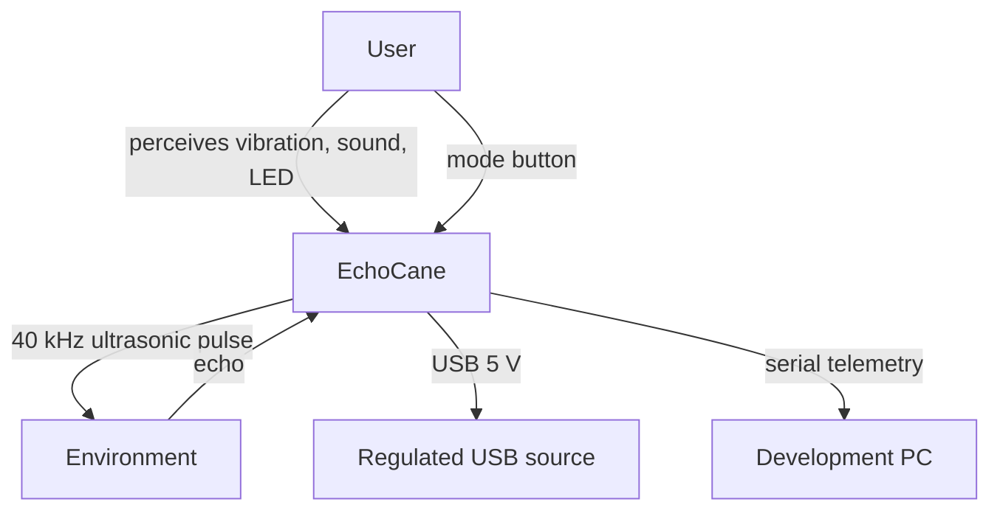
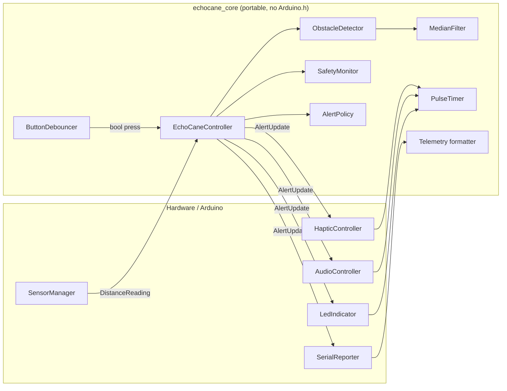
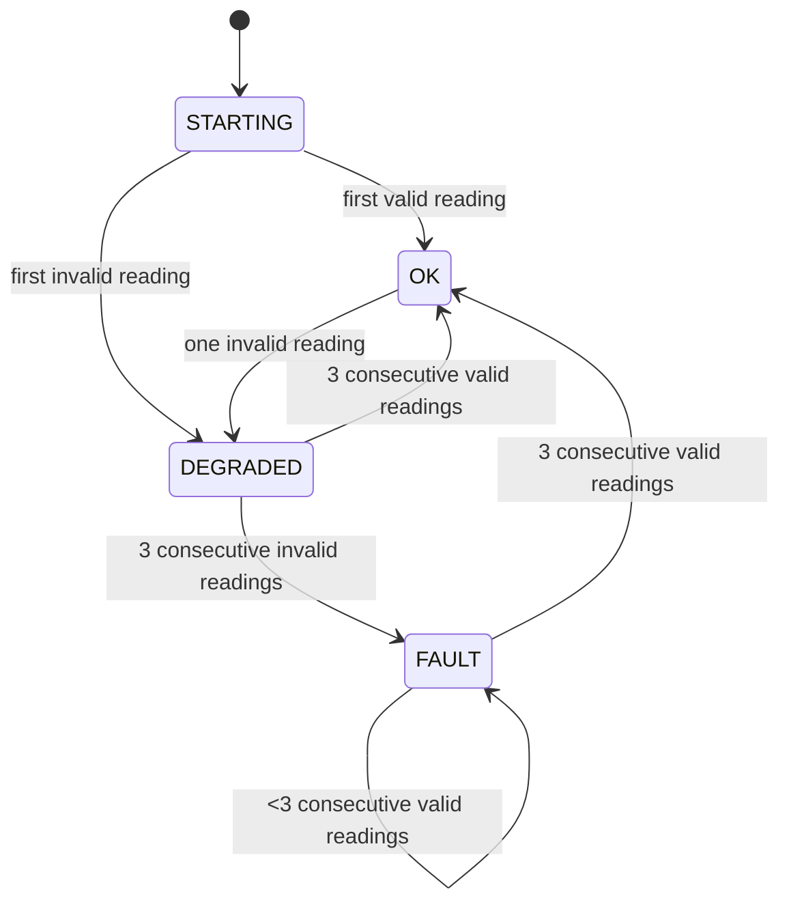
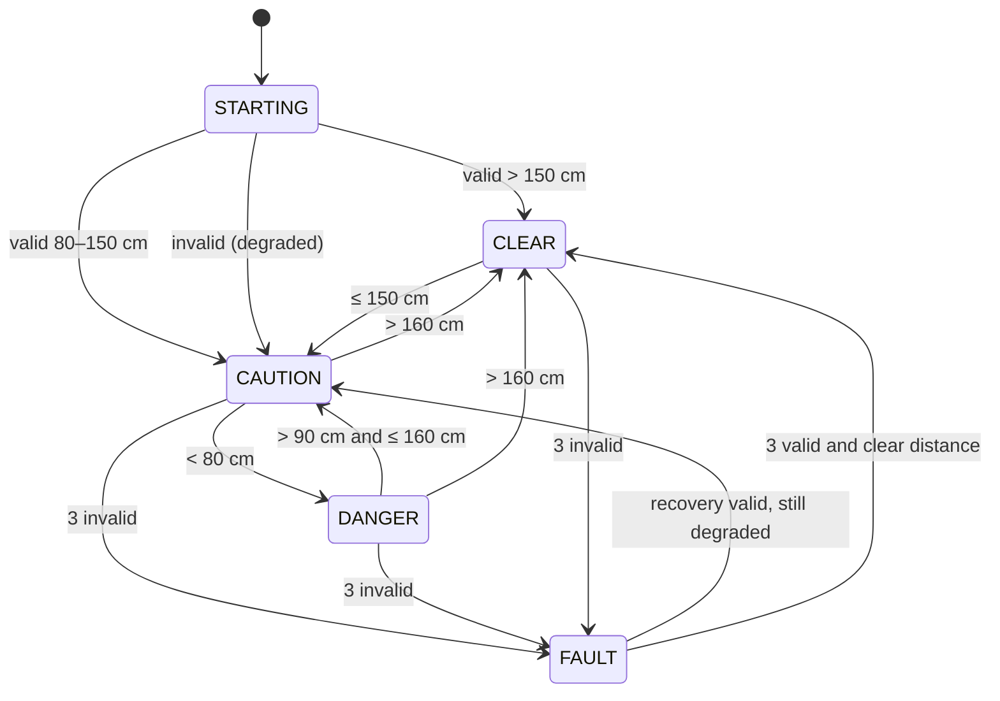

# Architecture

## 1. Design goals

EchoCane's architecture is driven by four constraints:

1. **Fail safe by policy, not by hope.** A sensor failure must never be presented
   as a clear path.
2. **Keep safety logic testable without hardware.** Distance classification,
   hysteresis, debouncing and fault recovery live in a portable C++ library.
3. **Fit a small MCU.** No dynamic allocation, bounded buffers, fixed-width
   types and a cooperative scheduler.
4. **Make every claim traceable.** The same pin map, net names and BOM are checked
   across firmware, simulation and KiCad.

## 2. System context



The device senses one forward cone. It does not build a map, localise itself or
classify objects. The output is a warning level, not a navigation instruction.

## 3. Layered structure



| Layer | Files | Responsibility | Knows about Arduino? |
|---|---|---|---|
| Portable core | `firmware/lib/echocane_core` | Classification, filtering, hysteresis, health, modes, patterns, timing primitives, formatting | No |
| Adapters | `firmware/src`, `firmware/include` | GPIO, `pulseIn`, `analogWrite`, `tone`, `millis`, `Serial` | Yes |
| Composition root | `main.cpp` | Constructs objects, schedules work, applies outputs | Yes |
| Verification | `firmware/test/test_core` | Host tests against the portable core | No |

`EchoCaneController` receives plain data (`DistanceReading`) and returns a plain
snapshot (`AlertUpdate`). It performs no I/O, so the same code runs on the host
and on the Nano.

## 4. Runtime data flow

```mermaid
sequenceDiagram
  participant Loop
  participant Sensor as SensorManager
  participant Ctrl as EchoCaneController
  participant Safety as SafetyMonitor
  participant Detector as ObstacleDetector
  participant Outputs
  participant Serial
  Loop->>Sensor: read() every 60 ms
  Sensor-->>Ctrl: DistanceReading
  Ctrl->>Safety: update(reading)
  Safety-->>Ctrl: health + accepted
  alt health == Fault
    Ctrl->>Detector: reset()
    Ctrl->>Ctrl: level = Fault
  else valid reading
    Ctrl->>Detector: update(cm)
    Detector-->>Ctrl: filtered level
    Ctrl->>Ctrl: enforce at least CAUTION while degraded
  else invalid reading
    Ctrl->>Ctrl: hold last warning, minimum CAUTION
  end
  Ctrl-->>Outputs: AlertUpdate (pattern)
  Ctrl-->>Serial: telemetry on interval or state change
```

The loop is cooperative:

| Task | Period / trigger | Bound |
|---|---|---|
| Button poll | 5 ms | `digitalRead` + integer comparison |
| Sensor scan | 60 ms | 10 µs trigger + `pulseIn` up to 25 ms |
| Haptic scheduler | every loop pass | arithmetic + `analogWrite` |
| Audio scheduler | every loop pass | arithmetic + `tone`/`noTone` on transitions |
| LED scheduler | every loop pass | arithmetic + `digitalWrite` |
| Telemetry | 500 ms (250 ms in Diagnostic) | one `snprintf` into a fixed buffer |
| Event report | level/health change or mode press | one formatted record |

The only long operation is `pulseIn`, bounded by `echoTimeoutUs = 25,000 µs`.
That is intentional and documented: it is a **bounded blocking** acquisition, not
an unbounded `delay()`. A future revision can replace it with input capture and
an interrupt-driven state machine.

All interval arithmetic uses unsigned subtraction `(now - last) >= interval`, so
it remains correct across `millis()` rollover.

## 5. Safety state machine

### 5.1 Sensor health



`SensorHealth` and `AlertLevel` are separate. Health is the evidence about the
sensor; alert level is what the user is told. The controller combines them.

### 5.2 Alert level



While `DEGRADED` or recovering, a valid clear distance is deliberately promoted
to at least `CAUTION`. This avoids a misleading "all clear" immediately after a
sensor dropout.

## 6. Class and interface contracts

| Type | Contract |
|---|---|
| `DistanceReading` | Status is exactly one of `Valid`, `Timeout`, `OutOfRange`; `centimeters` is meaningful only for valid/out-of-range. |
| `SafetyMonitor::update` | Counts consecutive outcomes; returns health and whether the sample may be used. A fault sample is not accepted by the detector. |
| `ObstacleDetector::update` | Adds a valid sample to the median filter and classifies the median with hysteresis. It cannot clear a fault on its own. |
| `EchoCaneController::update` | Composes health, filtered distance, mode and patterns into one `AlertUpdate`. Owns the fault reset. |
| `AlertPolicy::makeAlertCommand` | Pure mapping from level + mode + config to haptic/tone/LED patterns. |
| `PulseTimer` | Determines whether a pattern is in its on-phase; no hardware access. |
| `formatTelemetry` | Bounded formatting; returns a length that never exceeds the buffer. |

## 7. Configuration and tuning

All demonstration parameters are in `AppConfig.h`:

| Parameter | Default | Notes |
|---|---|---|
| `cautionThresholdCm` | 150 | Inclusive upper bound for caution |
| `dangerThresholdCm` | 80 | Exclusive upper bound for danger |
| `hysteresisCm` | 10 | Release margin |
| `minValidCm` / `maxValidCm` | 2 / 400 | HC-SR04 nominal range |
| `echoTimeoutUs` | 25,000 | Slightly above 400 cm round trip (~23.2 ms) |
| `scanIntervalMs` | 60 | Sensor update period |
| `faultAfterConsecutiveInvalid` | 3 | Fault confirmation |
| `recoverAfterConsecutiveValid` | 3 | Recovery confirmation |
| `buttonDebounceMs` | 30 | Firmware debounce |
| `telemetryIntervalMs` | 500 | Periodic telemetry |
| Haptic patterns | 40 %/180/320; 100 %/400/120 | Caution; danger |
| Fault haptic | 100 %/120/80 | Distinct from danger |
| Tones | 1800/2400/1000 Hz | Caution/danger/fault |
| LED patterns | heartbeat/blink/solid/fast blink | Clear/caution/danger/fault |

These are engineering defaults. They are not clinically validated.

## 8. Memory and performance

Final Nano build:

| Resource | Used | Available | Margin |
|---|---|---|---|
| Flash | 10,766 B | 30,720 B | 19,954 B (65 %) |
| RAM | 777 B | 2,048 B | 1,271 B (62 %) |

The median filter uses a fixed 5-element array and an insertion sort. Telemetry
uses a fixed `char` buffer. No heap allocation, STL containers or exceptions are
used in firmware. The main loop has no unbounded wait; the sensor acquisition has
a 25 ms upper bound.

## 9. Key decisions and trade-offs

| Decision | Rationale | Cost |
|---|---|---|
| Portable core + adapters | Host tests catch policy regressions without hardware | Slightly more plumbing |
| Net-label schematic | Generated connectivity is explicit, ERC-verifiable | Less pictorial than a hand-drawn schematic |
| Median filter, not mean | Rejects isolated spikes and preserves edges better | Five-sample latency; no formal filter design |
| Asymmetric hysteresis | Prevents chatter | 10 cm release band is a guess |
| Fault after 3 invalid | Avoids a single missed echo causing a fault | Up to 180 ms to confirm at 60 ms scans |
| Recovery after 3 valid | Avoids flickering back to clear | Up to 180 ms of caution after recovery |
| Bounded `pulseIn` | Simple, well understood on AVR | Blocks up to 25 ms |
| Through-hole carrier | Hand-solderable prototype | Larger board; not size-optimised |
| USB 5 V only | Avoids unverified Li-ion charging | Tethered operation |
| Generic KiCad symbols | Reproducible without vendor libraries | No manufacturer 3D model for the Nano; a CC0 candidate was not independently verified |

## 10. Extensibility

- Replace `SensorManager` with a Time-of-Flight or multiple-sensor adapter while
  keeping `DistanceReading` and the controller unchanged.
- Add a second sensor channel by fusing readings before `ObstacleDetector`, or by
  extending the core with a sensor-fusion policy.
- Replace `pulseIn` with timer input capture without changing the core.
- Add a wearable enclosure and a certified power path only after physical and
  user testing.
