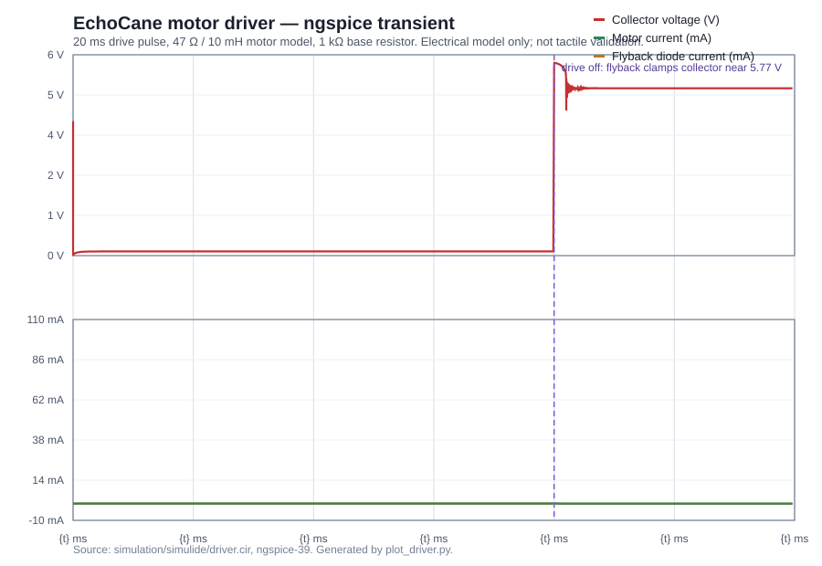

# Circuit explanation and calculations

This document explains the electrical intent behind the schematic and records the
calculations used to choose component values. Calculations are paper design
checks; the ngspice results are a simulation of a lumped model. Neither is a
bench measurement.

## 1. Power and ground

The board is powered from a regulated external 5 V USB source. The Nano's USB
connector is the mechanical and electrical entry point; the carrier board does
not include a second regulator or a battery charger.

- +5 V is distributed to the Nano 5V pin, J1.1 (HC-SR04), J2.1 (motor), D1
  cathode, C1.1 and C2.1.
- GND is distributed to the Nano GND pins, J1.4, Q1 emitter, R2.2, C1.2, C2.2,
  C3.2, D2 cathode, SW1.2 and BZ1.2.
- A bottom-layer GND zone provides the return path. Motor current returns from
  Q1's emitter to the ground zone; the +5 V feed and motor low side use wider
  0.8 mm tracks.

### 1.1 Estimated current

| Load | Estimate | Basis |
|---|---|---|
| Nano | 20 mA | Typical board quiescent current, not measured |
| HC-SR04 | 15 mA | Typical module peak, not measured |
| Motor | 100 mA | 5 V / 47 Ω design load |
| Buzzer | 10 mA | Piezo tone current estimate |
| LED | 13.6 mA | (5 − 2) V / 220 Ω |
| **Total** | **158.6 mA** | Sum of estimates |

A 500 mA USB source leaves 341 mA of headroom. Motor stall current is not known
and may exceed 100 mA; the source and wiring must be sized for the real motor.

## 2. Ultrasonic sensor interface

The HC-SR04 is a 5 V module:

- TRIG requires a high pulse of at least 10 µs.
- ECHO goes high for the round-trip time.
- The common approximation is `distance_cm = echo_high_us / 58`.
- The nominal range is 2–400 cm, so the maximum round-trip time is about
  `400 × 58 = 23,200 µs`.

Firmware sends a 10 µs pulse on D9 and measures ECHO on D10 with a 25,000 µs
timeout. The timeout is deliberately above the 23.2 ms maximum so a valid 400 cm
echo is not truncated at the 20 °C approximation. If ECHO never rises, `pulseIn`
returns 0 and the reading is `Timeout`. If the computed distance is below 2 cm or
above 400 cm, the reading is `OutOfRange`. The 343 m/s assumption is temperature-
dependent; at lower temperatures a 400 cm echo can approach the 25 ms limit. That
margin is documented, not measured.

The ECHO output is a 5 V logic signal. The Nano is a 5 V board, so no level
shifter is required. If a 3.3 V controller were substituted, a divider or level
shifter would be mandatory.

## 3. Vibration-motor driver

```text
+5 V ── J2.1 ── motor ── J2.2 ── Q1 collector
                                  │
                                  ├── D1 anode; D1 cathode to +5 V
                                  │
D6 ── R1 330 Ω ── Q1 base          │
                    │             │
                   R2 10 kΩ      Q1 emitter ── GND
                    │
                   GND
```

Q1 is a PN2222A NPN low-side switch. R1 limits base current; R2 keeps the base
low when D6 is floating or the MCU is resetting. D1 clamps the inductive kick when
Q1 turns off.

### 3.1 Base current

Using a conservative saturated base-emitter voltage of 1.2 V:

```text
Ib = (Vdrive − Vbe) / R1
   = (5.0 − 1.2) / 330
   = 11.5 mA
```

The ngspice model, with a Gummel-Poon transistor model, produced:

```text
Ib = 12.34 mA
Vbe = 0.926 V
```

Both are below the ATmega328P's recommended 20 mA continuous current per pin
(the absolute maximum is 40 mA) and leave margin. The 330 Ω resistor dissipates
at most:

```text
P_R1 = (5.0 − 1.2)² / 330 = 43.8 mW
```

### 3.2 Forced beta and load current

For a 100 mA motor:

```text
forced beta = Ic / Ib = 100 mA / 11.5 mA = 8.7
```

A forced beta at or below 10 is the conservative target for hard saturation. The
maximum base resistor for that target is:

```text
R1(max) = (5.0 − 1.2) / (100 mA / 10) = 380 Ω
```

330 Ω is below the 380 Ω limit, so the design meets its forced-beta target with
margin. The earlier 1 kΩ value was above the limit; the audit corrected both the
value and the sign of the design-margin check. If a lower-gain transistor or a
larger motor were used, R1 should be reduced further and the base current
recalculated against the Nano pin limit.

### 3.3 Output stage

The ngspice transient model uses a 47 Ω / 10 mH motor and a 20 ms drive pulse:

| Quantity | Result |
|---|---|
| Base current, drive high | 12.34 mA |
| Base-emitter voltage | 0.926 V |
| Motor current, on | 104.4 mA |
| Collector-emitter voltage, on | 0.094 V |
| Transistor dissipation, on | 9.8 mW |
| Motor voltage, on | 4.91 V |
| Collector peak at turn-off | 5.77 V |
| Flyback diode peak | 104.3 mA |

The motor inductance and the 100 mA load are assumptions. A 47 Ω, 10 mH lumped
model gives an
electrical time constant of:

```text
τ = L / R = 10 mH / 47 Ω = 213 µs
```

so the current reaches its steady value quickly compared with the 20 ms pulse.
The flyback diode carries the inductor current at turn-off and clamps the
collector near 5 V plus a diode drop; the simulated peak is 5.77 V. A 1N4007 is
rated for 1000 V and 1 A, far above this stress. Its relatively slow recovery is
acceptable for a small motor; a Schottky diode would reduce turn-off loss but is
not necessary for this prototype.



The waveform is generated from `simulation/simulide/driver.cir` by
`plot_driver.py`. It is a model, not a measurement of a physical motor.

### 3.4 Why a flyback diode is mandatory

Without D1, turning off Q1 would force the motor current to collapse through the
transistor's parasitic capacitance and the supply, producing a large inductive
spike that can exceed the transistor's Vce rating and disrupt the 5 V rail. D1
provides a confined path for the stored energy.

## 4. Status LED

D7 drives D2 through R3:

```text
I_LED = (5.0 − Vf) / 220 Ω
```

With a green LED Vf of about 2.0 V:

```text
I_LED = 3.0 / 220 = 13.6 mA
P_R3  = 3.0² / 220 = 40.9 mW
```

13.6 mA is within the Nano pin limit and provides a bright indicator. The LED is
a status/output proxy, not a substitute for the motor.

## 5. Mode button and debounce

SW1 connects D2 to GND. D2 is configured as `INPUT_PULLUP`, so the pin reads HIGH
when released and LOW when pressed. C3 (100 nF) from D2 to GND forms an RC filter
with the internal pull-up (approximately 20–50 kΩ):

```text
τ = R_pullup × C = 30 kΩ × 100 nF = 3 ms
```

The firmware additionally requires 30 ms of stable state. The hardware filter
removes fast contact bounce; the firmware debounce prevents a single press from
being counted multiple times. The RC time constant is an estimate because the
internal pull-up has a wide tolerance.

## 6. Buzzer

BZ1 is a 5 V piezo buzzer driven from D8 through R4 (100 Ω). The series resistor
limits current and reduces the load on the pin; a piezo element is largely
capacitive, so the DC current is small and the acoustic output depends on the
drive frequency and the buzzer's resonant frequency. The firmware uses `tone()`
on D8 with 1800 Hz (caution), 2400 Hz (danger) and 1000 Hz (fault). The actual
sound pressure level has not been measured.

## 7. Decoupling

- C1 (100 nF ceramic) is a high-frequency bypass for the motor/connector supply.
- C2 (10 µF electrolytic) provides bulk charge for motor starts and transients.
- The Nano module has its own USB input capacitance; no additional regulator is
  added.

The capacitors are placed near the motor connector and the +5 V distribution.
The bottom GND zone provides a short return path.

## 8. Signal integrity and protection

- Series resistors on the LED and buzzer limit pin current.
- R1 limits base current; R2 defines Q1's off state.
- D1 clamps the motor's inductive kick.
- The HC-SR04 ECHO is 5 V, compatible with the 5 V Nano.
- There is no reverse-polarity protection on the +5 V input. The design assumes a
  keyed/known USB source; a production version should add a fuse, reverse
  polarity protection and transient suppression.
- There is no ESD protection on the connectors. A production version should add
  TVS diodes or a protected connector.
- The motor connector is not keyed; the motor has no polarity requirement for
  vibration, but the wiring should be documented.

## 9. What the circuit does not prove

- The motor model does not prove torque, vibration amplitude, frequency or user
  perception.
- The buzzer model does not prove sound pressure level or audibility in noise.
- The HC-SR04 model does not reproduce acoustic beam width, multipath, soft or
  angled surfaces, or cross-talk.
- The 5 V USB source, connectors, PCB and assembly have not been physically
  tested. Motor stall current and starting torque are unknown; the 330 Ω base
drive is sized for the 100 mA model, not for an arbitrary stall condition.
- The calculations use generic transistor/diode models and estimated motor
  parameters.

These gaps are carried into the [safety analysis](safety-analysis.md) and
[simulation limitations](simulation-limitations.md).
