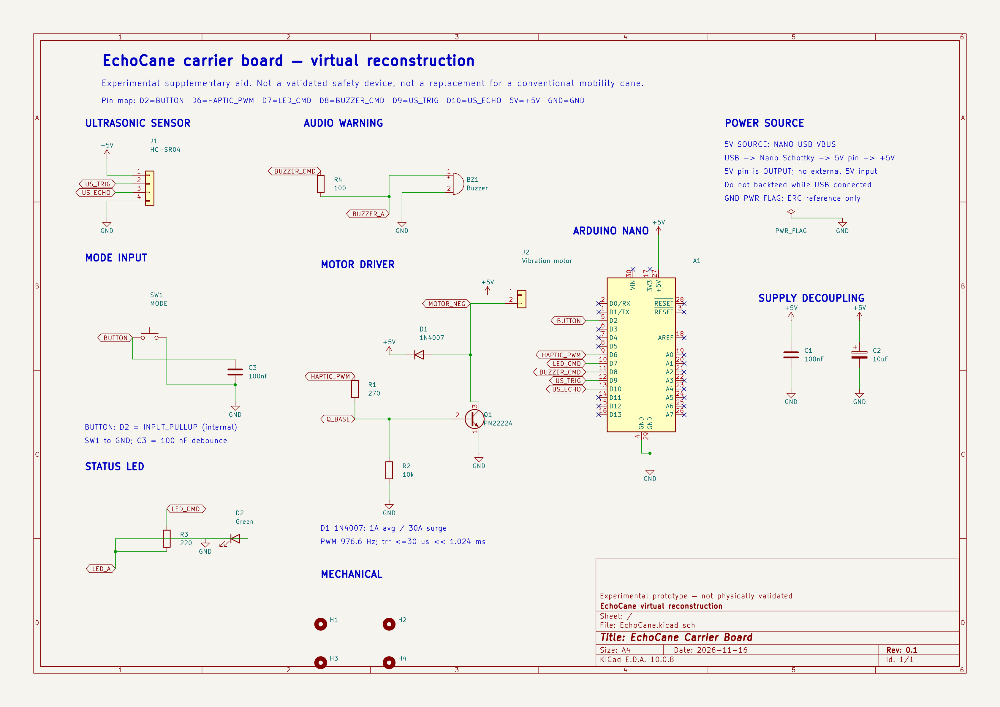

# Hardware design

## 1. Overview

EchoCane is a 100 × 85 mm, 2-layer carrier board around a classic 5 V Arduino
Nano. It is a hand-solderable prototype intended to demonstrate the electrical
architecture, not a production module. The board has not been fabricated or
assembled.



The A4-landscape schematic is organised into labelled functional sections. Local circuit
connections are drawn as orthogonal KiCad wires; global labels are reserved for
the long Nano-to-peripheral signal runs and for net-name continuity. The mode
input note records the firmware's internal pull-up (`INPUT_PULLUP`), with SW1
closing to GND and C3 providing the 100 nF debounce capacitance.

## 2. Component selection

| Ref | Part / value | Footprint | Why |
|---|---|---|---|
| A1 | Arduino Nano v3.x, ATmega328P, 16 MHz, 5 V | `Module:Arduino_Nano` | Required platform; 5 V logic matches HC-SR04 and 5 V actuator rail |
| J1 | 1×4, 2.54 mm header | `PinHeader_1x04_P2.54mm_Vertical` | HC-SR04 VCC/TRIG/ECHO/GND |
| J2 | 1×2, 2.54 mm header | `PinHeader_1x02_P2.54mm_Vertical` | Vibration motor, polarity not critical but documented |
| Q1 | PN2222A NPN, TO-92 | `TO-92_Inline` | Low-side switch; 500 mA class versus the 100 mA design point |
| R1 | 270 Ω, 0.25 W | `R_Axial_DIN0207` | Base current limit; 11.1 mA from a loaded 4.2 V GPIO, 11.0 mA into the base after R2 |
| R2 | 10 kΩ, 0.25 W | `R_Axial_DIN0207` | Base pull-down, keeps Q1 off during boot |
| D1 | 1N4007 | `D_DO-41_SOD81` | Flyback clamp for the inductive motor |
| C1 | 100 nF ceramic | `C_Disc_D5.0mm_W2.5mm_P5.00mm` | High-frequency motor decoupling |
| C2 | 10 µF electrolytic, 16 V+ | `CP_Radial_D5.0mm_P2.00mm` | Bulk energy for motor transients |
| SW1 | Momentary push button, 6 mm | `SW_PUSH_6mm` | Mode selection, active low |
| C3 | 100 nF ceramic | `C_Disc_D5.0mm_W2.5mm_P5.00mm` | Hardware RC debounce with internal pull-up |
| R3 | 220 Ω, 0.25 W | `R_Axial_DIN0207` | LED current limit, ~13.6 mA |
| D2 | Green LED, 5 mm | `LED_D5.0mm` | Status indicator |
| R4 | 100 Ω, 0.25 W | `R_Axial_DIN0207` | Buzzer series limit |
| BZ1 | 5 V piezo buzzer | `Buzzer_12x9.5RM7.6` | Optional audible warning |
| H1–H4 | M3 mounting holes, 3.2 mm | `MountingHole_3.2mm_M3` | Mechanical mounting; excluded from BOM |
| H5–H6 | Optional 1×15 socket headers (not in the design BOM) | `PinSocket_1x15_P2.54mm_Vertical` | Allows the Nano to be socketed; source separately if required |

The KiCad symbols are generic library symbols (`Device:R`, `Device:C`,
`Device:LED`, `Transistor_BJT:Q_NPN_EBC`, `MCU_Module:Arduino_Nano_v2.x`). The
PN2222A and 1N4007 are selected by value/footprint, not by a vendor SPICE model.
A production BOM would need manufacturer part numbers, tolerances, voltage
ratings, current ratings and a second-source plan.

### 2.1 Why a BJT, not a MOSFET?

A PN2222A is inexpensive, through-hole and easy to hand-solder. The corrected
calculation uses the ATmega328P's guaranteed **VOH ≥ 4.2 V at −20 mA**, not an
ideal 5 V pin. With a 270 Ω resistor and the 10 kΩ pull-down, the pin sources
11.1 mA, the pull-down diverts 0.12 mA, and Q1 receives 11.0 mA. At the 100 mA
design point that is a forced beta of 9.1, inside the conservative target of 10.
The pin current remains below the recommended 20 mA continuous limit (absolute
maximum 40 mA). Q1 dissipates about 9.9 mW in the simulated on-state; the paper
calculation uses a conservative 30 mW.

A 330 Ω resistor is **not** defensible with the loaded pin: it would deliver
8.97 mA and a forced beta of 11.1 at 100 mA. A 300 Ω resistor is also marginally
above the calculated loaded limit (about 296 Ω), so 270 Ω is the selected E24
value.

### 2.2 Driver alternatives considered

| Option | Drive / loss at 100 mA | Assessment |
|---|---|---|
| 330 Ω + PN2222A | 8.97 mA base; forced beta 11.1; R1 27.3 mW | **Rejected**: misses the forced-beta-10 target with loaded GPIO and R2 |
| 300 Ω + PN2222A | 9.88 mA base; forced beta 10.12; R1 30.0 mW | **Rejected**: marginal failure of the same target; no demonstrated benefit over 270 Ω |
| **270 Ω + PN2222A** | **11.0 mA base; forced beta 9.10; R1 33.3 mW** | **Selected**: fits existing TO-92 footprint and pin budget |
| IRLZ44N logic-level MOSFET | 35 mΩ vendor 4.5 V max; 39 mΩ conservative bound; 0.39 mW at 100 mA; 66 nC max gate charge | Electrically viable, but TO-220 does not fit the TO-92 footprint and the board/gate-drive/ESD changes are not justified for 100 mA |

The MOSFET comparison uses the vendor parametric maximum of 35 mΩ at VGS = 4.5 V
and the more conservative 39 mΩ maximum specified at VGS = 4 V (the 5 V maximum
is 28 mΩ). The IRLZ44N is a 55 V, 47 A TO-220 device with a 1–2 V gate
threshold. Its gate charge is much larger than the BJT base charge and would need
a gate resistor and pull-down. The PN2222A remains the appropriate revision-0.1
choice; the MOSFET is documented as a future alternative, not silently selected
because it makes a spreadsheet pass.

## 3. Pin assignment

| Nano pin | Port | Net | Destination |
|---|---|---|---|
| D2 | PD2 | `BUTTON` | SW1 to GND; internal pull-up; 100 nF to GND |
| D6 | PD6 / Timer0A | `HAPTIC_PWM` | R1 → Q1 base |
| D7 | PD7 | `LED_CMD` | R3 → D2 anode |
| D8 | PB0 | `BUZZER_CMD` | R4 → BZ1 |
| D9 | PB1 | `US_TRIG` | J1 pin 2 |
| D10 | PB2 | `US_ECHO` | J1 pin 3 |
| 5V | — | `+5V` | J1.1, J2.1, D1 cathode, C1.1, C2.1 |
| GND | — | `GND` | J1.4, Q1.1, R2.2, C1.2, C2.2, C3.2, D2.1, SW1.2, BZ1.2 |

The same map is asserted by `tests/validate_hardware.py`, which parses
`Pins.h`, the KiCad netlist, the BOM and `simulation/wokwi/diagram.json`.

### 3.1 Connector pinouts

**J1 — HC-SR04**

| Pin | Signal | Note |
|---|---|---|
| 1 | +5 V | Sensor supply |
| 2 | TRIG | Nano D9 |
| 3 | ECHO | Nano D10, 5 V echo |
| 4 | GND | Common ground |

**J2 — vibration motor**

| Pin | Signal |
|---|---|
| 1 | +5 V |
| 2 | Motor negative / Q1 collector |

The motor is inductive; D1 is connected with cathode to +5 V and anode to the
collector so that turn-off current freewheels through the diode.

### 3.2 Flyback diode verification

D6 is driven by the ATmega328P Timer0A through Arduino `analogWrite()`; the
classic Nano default is **976.56 Hz**, so the PWM period is **1.024 ms**.

The selected D1 is a **1N4007** standard-recovery rectifier:

| Parameter | 1N4007 | Design stress |
|---|---|---|
| Average forward current | 1.0 A at 75 °C lead temperature | 100 mA design point; 150 mA stress case |
| Non-repetitive surge | 30 A (8.3 ms half-sine) | Motor turn-off/start transient; not measured |
| Reverse voltage | 1000 V | About 5 V rail plus clamped inductive kick |
| Reverse recovery | About 2 µs typical; 30 µs conservative maximum | 30 µs is 2.9% of the 1.024 ms period |

At the 100 mA design point the average forward-current margin is 10:1; even the
150 mA stress case retains 6.7:1. At 40% duty the diode carries the motor
freewheel current for roughly 60% of each period, so its average current is
expected to be below 60 mA. The 1N4007 is not a fast-recovery or Schottky diode,
but at 976.56 Hz its recovery interval is a small fraction of the period and the
5 V/100 mA stress is far below its voltage and current ratings. **No diode
change is justified for the present design.** A 1N5819 Schottky or UF4007 would
reduce forward drop and recovery loss if the PWM frequency were raised to tens
of kilohertz, or if a measured motor stall current approached the ampere range.
Motor stall current remains **NOT VERIFIED**.

## 4. Power architecture

The carrier board has **no separate 5 V regulator and no external 5 V input
connector**. The sole source is the Nano module's USB connection to a
commercially manufactured regulated 5 V USB source. On a classic Nano, USB VBUS
passes through the module's onboard Schottky diode (and, on genuine boards, its
resettable fuse) to the module's 5 V rail. The module's **5V pin is an output**
that exposes that rail; the carrier's `+5V` net is therefore driven by A1 pin 27,
not by a carrier-side source. There is no battery, charger, boost converter or
Li-ion protection circuit in this design.

### 4.1 USB power, 5V output and backfeed

- The USB connector on the Nano is the mechanical and electrical entry point;
  the carrier does not have a second 5 V connector.
- Do **not** feed an external 5 V supply into the carrier `+5V` net or the Nano
  5V pin while USB is connected. The 5V pin is an output, bypasses the Nano's
  input diode/regulator path, and an external source can backfeed the USB host or
  the module's regulator. The intended configuration is USB only.
- No external-source ORing, ideal-diode, fuse or reverse-feed protection is
  fitted on the carrier. If a future revision adds an external 5 V input, it must
  add and validate that protection rather than paralleling the Nano 5V pin.
- The schematic has a `PWR_FLAG` on **GND only**. `+5V` is already driven by the
  Nano's power-output pin; adding a `+5V` PWR_FLAG would create an ERC
  power-output conflict. The GND flag is an ERC reference marker, not a physical
  component.
- Verify the actual Nano module. Some low-cost clones omit or alter the USB fuse
  or Schottky diode; the backfeed statement above assumes a genuine/known classic
  Nano with the documented input protection. That module-level assumption is
  **NOT VERIFIED** for an arbitrary clone.

### 4.2 Estimated current budget

| Load | Estimate |
|---|---|
| Nano board allowance | 25 mA |
| HC-SR04 peak | 15 mA |
| Vibration motor (design point) | 100 mA |
| GPIO/base-drive current through R1 | 11.1 mA |
| Buzzer | 10 mA |
| Status LED | 13.6 mA |
| **Total design estimate** | **174.7 mA** |
| USB 500 mA budget margin | 325.3 mA |

The 25 mA Nano allowance covers the ATmega plus the board's USB-serial and power
LED; it is an estimate, not a measurement. The 11.1 mA is the current sourced by
D6 through R1; the 0.12 mA through R2 is part of that current, not an additional
supply load. These are design estimates. **Motor stall current is not verified**
and may exceed 100 mA; the USB source, connector and 0.8 mm traces must be sized
for the actual motor. The selected 270 Ω drive supports at most about 110 mA at
the forced-beta-10 target; a 150 mA stress case would have a forced beta of 13.6
and is not covered by that target. The board tracks are 0.5 mm for signals and
0.8 mm for motor and +5 V distribution.

### 4.3 Decoupling and grounding

- C1 (100 nF) is placed near the motor/connector supply; C2 (10 µF) provides
  bulk energy.
- The Nano's own USB supply decoupling is assumed; no additional 5 V regulator is
  added.
- A bottom-layer GND zone provides a low-inductance return. Motor current returns
  through the zone to the Q1 emitter/ground area.
- The HC-SR04 and motor connectors share the same ground reference as the Nano.
- There are no vias; all connections are routed on the top layer except the
  bottom-layer +5 V distribution and the GND zone. This is a simple 2-layer
  prototype, not an EMC-optimised layout.

## 5. Schematic design

The schematic is organised into labelled functional blocks:

1. **Ultrasonic sensor** — J1 and its four net connections.
2. **Mode input** — SW1, C3 and the `BUTTON` net.
3. **Status LED** — R3 and D2.
4. **Motor driver** — J2, Q1, R1, R2, D1 and the motor nets.
5. **Audio warning** — R4 and BZ1.
6. **Supply decoupling** — C1 and C2.
7. **Arduino Nano** — all 30 pins, with no-connect markers on unused pins.
8. **Power source** — USB/Nano source note and a GND `PWR_FLAG`; `+5V` is driven by the Nano 5V output.
9. **Mechanical** — H1–H4, excluded from the BOM.

Local block connections are drawn as visible orthogonal wires: the motor base
network, collector/emitter return, flyback diode, button/capacitor parallel
network, LED series path, buzzer path, connector power stubs and Nano ground
pins all have explicit copper-style wires and junctions. Global labels connect
only the long Nano-to-peripheral signal runs, so the same net names connect
across the sheet and match the PCB netlist. The Nano's two adjacent GND pins are
joined with wires to one GND symbol.

### 5.1 ERC result

```text
ERC messages: 0  Errors 0  Warnings 0
```

Report: [`hardware/verification/schematic-erc.rpt`](../hardware/verification/schematic-erc.rpt).

The ERC report lists ignored checks (global label appearing once, four connection
points joined, footprint filter mismatch). These are configuration-level checks,
not unresolved electrical errors. The generated schematic uses generic symbols,
so footprint-filter mismatch is expected and is documented rather than hidden.

### 5.2 ERC fixes made during development

- Mounting holes were marked `in_bom no` in the schematic and excluded from the
  BOM to remove four schematic-parity warnings.
- Local labels were replaced with global labels to remove local/global name
  conflicts on `+5V` and `GND`.
- A `PWR_FLAG` on +5 V conflicted with the Nano's power-output pin; it was
  removed. The Nano's 5 V pin is the source, and the GND net has a `PWR_FLAG`.

## 6. PCB design

| Property | Value |
|---|---|
| Board size | 100 × 85 mm |
| Layers | 2 (F.Cu, B.Cu) |
| Thickness | 1.6 mm |
| Minimum track width | 0.5 mm |
| Minimum clearance | 0.62 mm |
| Minimum drill | 0.75 mm |
| Pads | 63 PTH, 4 NPTH |
| Vias | 0 |
| Electrical footprints | 15 THT |
| Mounting holes | 4 × M3 (3.2 mm NPTH) |

### 6.1 Placement

- The Nano sits centrally with its USB connector facing the board edge for cable
  access.
- J1 (HC-SR04) is on the left edge, close to D9/D10, with short trigger/echo
  routes.
- SW1 and C3 are on the left, away from the motor and buzzer.
- The motor driver (Q1, R1, R2, D1, J2) is on the right, close to the motor
  connector and the +5 V/GND distribution.
- BZ1 and R4 are at the top right, away from the ultrasonic connector.
- C1/C2 are near the motor supply. The audit moved C2 to (90, 50) mm so the two
  5 mm bodies have visible mechanical clearance; C1 remains at (80, 45) mm.
- H1–H4 are at the corners.

### 6.2 Routing

- All signal tracks are 0.5 mm on the top copper.
- The motor low side and +5 V distribution are 0.8 mm.
- The +5 V bus and the buzzer command run on the bottom copper under the Nano;
  the GND zone clears around them.
- There are no vias; this keeps the prototype simple and avoids via reliability
  questions, at the cost of using the bottom layer for only two nets and the zone.

### 6.3 Silkscreen

- `ECHOCANE v0.1`
- `EXPERIMENTAL AID - NOT A VALIDATED SAFETY DEVICE`
- Connector/function labels: `HC-SR04`, `MOTOR`, `MODE`, `BUZZER`, `+5V GND`,
  `D9 TRIG / D10 ECHO`
- Reference designators for all footprints, positioned clear of bodies where
  possible.

The top 3D render shows the intended assembly. Reference designators under
through-hole bodies (for example Q1) may be hidden after assembly; this is normal
for a prototype silkscreen.

### 6.4 DRC result

```text
Found 0 violations
Found 0 unconnected items
Found 0 schematic parity issues
```

Report: [`hardware/verification/pcb-drc.rpt`](../hardware/verification/pcb-drc.rpt).

Earlier iterations had four parity warnings because the mounting holes were in
the BOM in the schematic but excluded on the PCB. That mismatch was fixed by
setting `in_bom no` in the schematic and excluding the holes from the BOM. A
later net-name change from local labels (`/BUTTON`) to global labels (`BUTTON`)
required regenerating the PCB from the new netlist; after regeneration the
parity check is clean.

### 6.5 Board statistics

```text
Width 100.0000 mm, height 85.0000 mm, area 8500 mm²
63 through-hole pads, 4 NPTH, 0 vias
15 THT footprints + 4 mounting holes
```

Full report: [`hardware/verification/pcb-stats.txt`](../hardware/verification/pcb-stats.txt).

## 7. Manufacturing outputs

All files are in [`hardware/gerber/`](../hardware/gerber/) and
[`hardware/pcb/`](../hardware/pcb/):

| File | Purpose |
|---|---|
| `EchoCane-F_Cu.gtl` | Front copper |
| `EchoCane-B_Cu.gbl` | Back copper |
| `EchoCane-F_Silkscreen.gto` | Front silkscreen |
| `EchoCane-B_Silkscreen.gbo` | Back silkscreen |
| `EchoCane-F_Mask.gts` | Front solder mask |
| `EchoCane-B_Mask.gbs` | Back solder mask |
| `EchoCane-Edge_Cuts.gm1` | Board outline |
| `EchoCane.drl` | Excellon drill, metric |
| `EchoCane-drl_map.pdf` | Drill map |
| `EchoCane-job.gbrjob` | Gerber job file |
| `EchoCane.step` | 3D STEP of the board and available models |
| `EchoCane-pcb.pdf` / `.svg` | Documentation plots |
| `EchoCane-schematic.pdf` / SVG | Schematic documentation |

No paste layers are generated because the design is all through-hole. No
assembly drawing, pick-and-place file or fabrication note is included; a
production release would add those.

### 7.1 3D model caveat

The KiCad library installed in the container does not include the Arduino Nano
module's vendor STEP model (`Module.3dshapes/Arduino_Nano_WithMountingHoles.step`).
The board and all other available component models are in the STEP and renders;
A1 appears as its footprint/outline. This is a library limitation, not a PCB
error. A CC0 candidate Nano model (`g200kg/kicad-lib-arduino`, x3d) was located
during the audit, but its dimensions and origin were not independently verified;
it is therefore not included in this revision. See the limitations register.

## 8. Independent audit corrections

The independent audit first corrected the inverted forced-beta inequality and
changed R1 from 1 kΩ to 330 Ω. The follow-up margin review found that result still
assumed an ideal 5 V GPIO and omitted R2. Using the datasheet VOH limit of 4.2 V
at 20 mA, 330 Ω gives only 8.97 mA and a forced beta of 11.1; 300 Ω is also above
the loaded 296 Ω limit. **R1 is therefore 270 Ω**, which gives 11.0 mA of base
current and a forced beta of 9.1. The optional H5–H6 BOM row was removed, C2 was
moved for mechanical clearance, the board title/revision metadata was restored,
and every manufacturing/plot output was regenerated. DRC and ERC remained clean.

## 9. Verification summary

| Check | Result |
|---|---|
| ERC | 0 errors, 0 warnings |
| DRC | 0 violations |
| Unconnected pads | 0 |
| Schematic parity | 0 issues |
| Cross-artifact pin/net/BOM check | PASS |
| Board statistics | Generated |
| Gerbers/drill/STEP | Generated; Gerber content matches the current board except timestamp metadata |
| BOM | 15 electrical rows; optional H5–H6 headers are not in the design BOM |
| Independent engineering audit | PASS for available checks; see [`audit-report.md`](audit-report.md) |
| Fabrication/assembly test | **Not performed** |
| Electrical bench test | **Not performed** |

A clean ERC/DRC means the design is internally consistent under the configured
rules. It does not prove that the board can be manufactured, assembled or used
safely.
